<textarea id="source">

<h1 class="slide-header">Styling Text with CSS</h1>

<span id=time-estimate class="color-grey-500">30 mins</span>

<p id="lesson-description">
Ever struggled to read a website on your phone because the text was too small? Or maybe the font color blended into the background, making it hard to see?

Good text styling isn’t just about looks—it’s about **readability**. The right fonts and styles make your website easier to read and more engaging for visitors.

In this lesson, we’ll show you how to choose **clear, user-friendly fonts** and style them effectively to improve the experience for everyone!

</p>

<h5 id="topics-header" class="color-grey-500">Topics</h5>

Font Styles in CSS

<hr>

Using Classes and IDs in CSS

<hr>

<a href="./assets/styling_text_with_css_study_guide.pdf" target="_blank" download="styling_text_with_css_study_guide.pdf" class="ant-btn" data-trackable="true" data-track-category="study guide" data-track-section="lesson page" data-track-action="download study guide"><span role="img" class="anticon"><svg viewBox="0 0 16 16" width="1em" height="1em" fill="currentColor" aria-hidden="true" focusable="false" class=""><g class="download_svg__nc-icon-wrapper"><path d="M8 12c.3 0 .5-.1.7-.3L14.4 6 13 4.6l-4 4V0H7v8.6l-4-4L1.6 6l5.7 5.7c.2.2.4.3.7.3z"></path><path data-color="color-2" d="M1 14h14v2H1z"></path></g></svg></span><span> Download Study Guide</span></a>

---

<h1 class="slide-header">Learning Objectives</h1>

<p>By the end of this lesson, you'll be able to:</p>

<ul>
  <li>Change the size and style of your fonts with CSS.</li>
  <li>Import fonts to a webpage.</li>
  <li>Use classes and IDs to style specific parts of your HTML.</li>
</ul>

---

<h1 class="slide-header">Let's Get Back to Work</h1>

In the last lesson, we applied some basic styling to Hannah’s website, as shown below. We also explored a few important CSS properties that help style different sections of a page:

- `background-color` - Sets the background color of an element.
- `color` - Changes the text color.
- `text-align` - Aligns text within an element (centering content on the page).

Great progress so far!
Now, let's review these text-styling properties and introduce a few new ones!

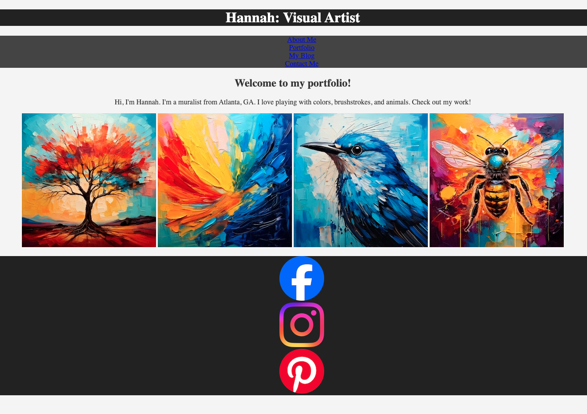

---

<h1 class="slide-header">Text-Styling Properties</h1>

### color

The `color` property controls the color of text on a webpage.

You can set the `color` property in three different ways:

- **Named Colors** – Use a standard color name, like `red`.
- **Hex Codes** – Use a six-digit code that represents a specific color, such as `#f142a3`.
- **RGB Values** – Define a color by specifying its red, green, and blue (RGB) values, such as `rgb(226, 28, 35)`.

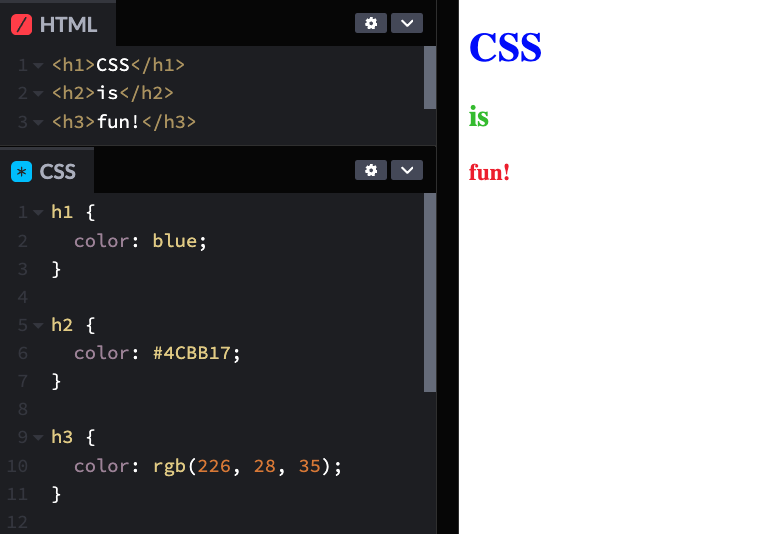

---

<h1 class="slide-header">Text-Styling Properties</h1>

### font-size

The `font-size` property controls —you guessed it— the size of text on a webpage. By default, some HTML elements have different font sizes—`h1` is the largest, followed by `h2`, and so on. However, you can customize these sizes to fit your design.

Here are two ways to set `font-size`:

- **Pixels** `px` – Set an exact size in pixels.

- **Relative Units** `em` – The size is based on the font size of the element it is inside (its parent).

If the parent element is the `<body>`, the font size of the text will be based on the **default font size of the browser**, which is usually `16px` unless changed:

- `font-size: 0.5em;` makes the text `8px` (_half_ the parent's size).
- `font-size: 2em;` makes the text `32px` (_twice_ the parent's size).

Using relative units `em` allows for better responsiveness, making text sizes more flexible across different screen sizes.

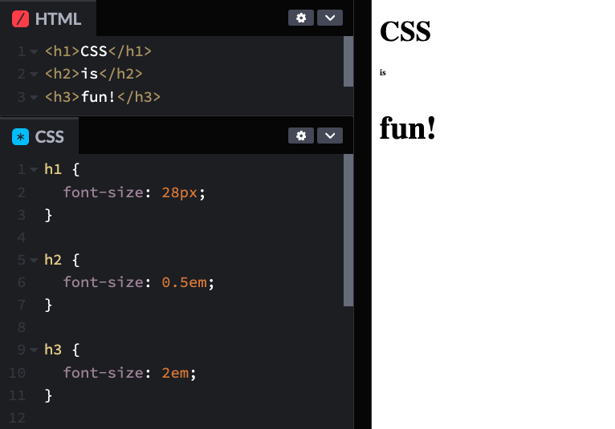

---

<h1 class="slide-header">Text-Styling Properties</h1>

### font-weight

The `font-weight` property controls how _thick_ or _bold_ text appears.

You can set `font-weight` in two ways:

- **Named Value** `bold` – Works like the bold option in a word processor.
- **Numeric Scale** `100–900` – Allows more control over thickness, where:
  - `100` is the thinnest
  - `400` is normal text
  - `700` is bold
  - `900` is the thickest

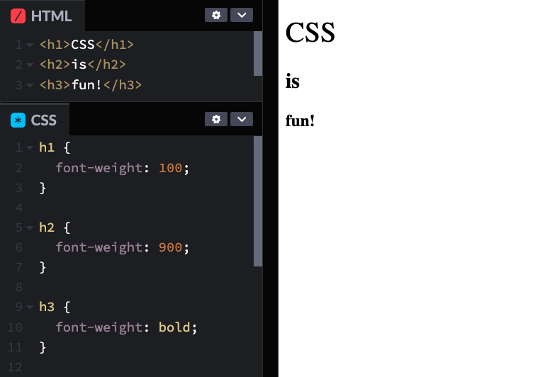

---

<h1 class="slide-header">Text-Styling Properties</h1>

### font-style

The `font-style` property is used to change the appearance of text, most commonly to make it **italic**, just like in a word processor.

- To make text italic, use: `font-style: italic;`

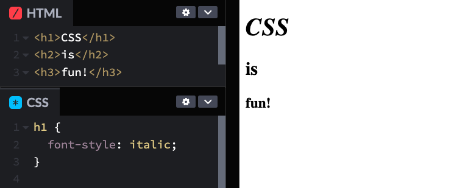

---

<h1 class="slide-header">Text-Styling Properties</h1>

### text-transform

The text-transform property controls whether text appears in uppercase, lowercase, or capitalized format.

- **Lowercase** – Converts all letters to lowercase with `text-transform: lowercase;`
- **Uppercase** – Converts all letters to UPPERCASE with `text-transform: uppercase;`
- **Capitalize** – Capitalizes the first letter of each word with `text-transform: caitalize;`

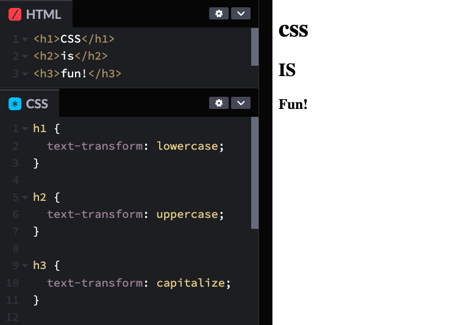

---

<h1 class="slide-header">Text-Styling Properties</h1>

### text-decoration

The `text-decoration` property allows you to add or remove lines under or through text.

Here are the most common uses:

- **Underline text**: `text-decoration: underline;`
- **Strike through text**: `text-decoration: line-through`
- **Remove underlines**: `text-decoration: none;`

Most frequently, it’s used to **remove the default underline for hyperlinks** (the `<a>` tag in HTML) by setting the value to none.

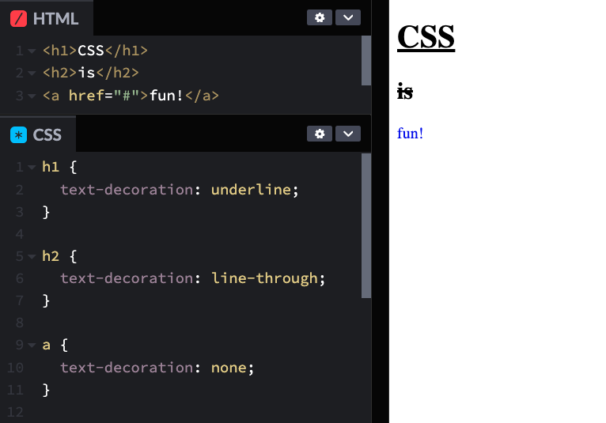

---

<h1 class="slide-header">Text-Styling Properties</h1>

### text-align

The text-align property controls how text is positioned within an element—just like alignment options in a word processor.

- **Left-aligned** (default): `text-align: left;`
- **Centered**: `text-align: center;`
- **Right-aligned**: `text-align: right;`

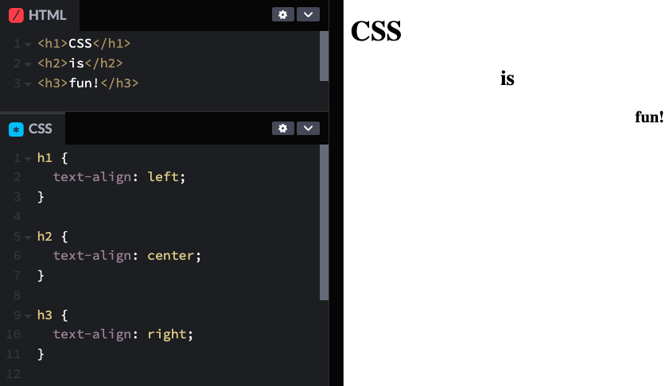

---

<h1 class="slide-header">Knowledge Check</h1>

What is the output of the following code?

```css
h2 {
  text-align: center;
  color: #fa8072;
  text-decoration: line-through;
  font-weight: bold;
  font-size: 14px;
}
```

<fieldset>
  <legend>Please select all that apply</legend>
  <input type="checkbox" id="uniqueAnswer" name="unique" correct="true"/><label for="uniqueAnswer">The h2 is centered</label><br />
  <input type="checkbox" id="uniqueAnswer4" name="unique4" correct="true"/><label for="uniqueAnswer4">The h2 is 14px</label><br />
  <input type="checkbox" id="uniqueAnswer2" name="unique2" /><label for="uniqueAnswer2">The h2 is all lowercase</label><br />
  <input type="checkbox" id="uniqueAnswer3" name="unique3" correct="true"/><label for="uniqueAnswer3">The h2 text has a strikethrough</label><br />
</fieldset>

<button class="ant-btn ant-btn-primary multiple-choice-checkbox-submit">Submit Answer</button>

---

<h1 class="slide-header">Checking In With Our Client</h1>

Let's apply some font styling! Hannah wants her name to stand out, so we'll make the headline larger and make some other text adjustments throughout the page.

**1. Style the `<h1>` heading:**

- Create a CSS rule for the `h1`.
- Set its font size to **`2.5em`**.

**2. Style the `<h2>` heading:**

- Create a CSS rule for the `h2`.
- Set its font size to **`1.8em`**.

**3. Style the `<span>` inside the paragraph:**

- Find the `<span>` that wraps the text for Hannah’s hometown.
- Set the font to **`bold`** and change the color to **`#d35400` (burnt orange)**.

<!-- styling-text-with-css-hannahs-site-3 -->
<iframe sandbox="allow-scripts allow-top-navigation allow-top-navigation-by-user-activation allow-forms allow-popups allow-same-origin"  height="400" style="width: 100%;" scrolling="no" title="Checking In with Our Client" src="https://codepen.io/GAmarketing/embed/xbxrZMp?default-tab=css%2Cresult&editable=true" frameborder="no" loading="lazy" allowtransparency="true" allowfullscreen="true">
  See the Pen <a href="https://codepen.io/GAmarketing/pen/xbxrZMp">
  ATL Pride</a> by General Assembly (<a href="https://codepen.io/GAmarketing">@GAmarketing</a>)
  on <a href="https://codepen.io">CodePen</a>.
</iframe>

<small><strong>TIP:</strong> After updating your code, click the <strong>"Run"</strong> or <strong>"Rerun"</strong> button in CodePen to make sure your changes take effect. Then, check <strong>View Test Results</strong> to see if your updates pass!</small>

---

<h1 class="slide-header">Styling Link Text</h1>

The text on the website is looking great, but there's one section we haven't styled yet—Hannah's navigation links.

To style the links, we need to **target the `<a>` tags inside the `<nav>` element**.

We can do this using the following syntax:

```css
nav a {
  /* This will style only the <a> tags inside the <nav> element */
  /* It ignores all other <a> tags on a page! */
}
```

**1. Select the `<a>` tags inside the `<nav>` by writing a new CSS rule for `nav a`.**

**2. Remove the underline – Set the text decoration to `none` so links are not underlined.**

**3. Change the text color – Set the color to white `#ffffff` so the links stand out against the background.**

**4. Make the text bold – Apply `bold` font weight to make the links more prominent.**

<!-- styling-text-with-css-hannahs-site-4 -->
<iframe sandbox="allow-scripts allow-top-navigation allow-top-navigation-by-user-activation allow-forms allow-popups allow-same-origin"  height="400" style="width: 100%;" scrolling="no" title="Styling Link Text" src="https://codepen.io/GAmarketing/embed/pvowEZg?default-tab=css%2Cresult&editable=true" frameborder="no" loading="lazy" allowtransparency="true" allowfullscreen="true">
  See the Pen <a href="https://codepen.io/GAmarketing/pen/pvowEZg">
  Checking In With Our Client</a> by General Assembly (<a href="https://codepen.io/GAmarketing">@GAmarketing</a>)
  on <a href="https://codepen.io">CodePen</a>.
</iframe>

<small><strong>TIP:</strong> After updating your code, click the <strong>"Run"</strong> or <strong>"Rerun"</strong> button in CodePen to make sure your changes take effect. Then, check <strong>View Test Results</strong> to see if your updates pass!</small>

---

<h1 class="slide-header">Pseudo Classes</h1>

Let’s take another look at the links in Hannah’s navigation menu. Right now, they are styled but don't stand out when hovered over. To improve the user experience, we can make the link color change when someone **hovers over** it.

In CSS, we can use the `hover` pseudo-class to style links when a user moves their mouse over them.

```css
nav a:hover {
  color: #ffdc00ff;
}
```

**1. Add a new CSS rule that targets the `hover` state of _only_ the `<a>` tags inside the `<nav>`.**

**2. Inside the rule, set a new text color to make the links visually change when hovered over.**

**3. Choose a color that stands out but still fits the overall design of the website.**

Once you’ve added this, try hovering over the links and see how they respond!

<!-- styling-text-with-css-hannahs-site-5 -->
<iframe sandbox="allow-scripts allow-top-navigation allow-top-navigation-by-user-activation allow-forms allow-popups allow-same-origin"  height="400" style="width: 100%;" scrolling="no" title="A Cool Trick" src="https://codepen.io/GAmarketing/embed/dPyRpBq?default-tab=css%2Cresult&editable=true" frameborder="no" loading="lazy" allowtransparency="true" allowfullscreen="true">
  See the Pen <a href="https://codepen.io/GAmarketing/pen/dPyRpBq">
  A Cool Trick</a> by General Assembly (<a href="https://codepen.io/GAmarketing">@GAmarketing</a>)
  on <a href="https://codepen.io">CodePen</a>.
</iframe>

<small><strong>TIP:</strong> After updating your code, click the <strong>"Run"</strong> or <strong>"Rerun"</strong> button in CodePen to make sure your changes take effect. Then, check <strong>View Test Results</strong> to see if your updates pass!</small>

---

<h1 class="slide-header">Checking In</h1>

Hannah said the site is really coming together! We’ve even added some interactive links that change color when hovered over—nice work!

But something still feels off… The navigation links and social media icons in the footer have bullets next to them. That’s because they’re inside unordered lists `<ul>`.

Wouldn’t it be great if we could remove those bullets, just like we removed the default underlines from links?

Good news—we can! Let’s clean up the design by getting rid of those bullets.

---

<h1 class="slide-header">List Styling</h1>

When we add a list in HTML, it comes with _default styling_:

- **Ordered lists `<ol>`** use **numbers**.
- **Unordered lists `<ul>`** use **solid bullet points**.

We can **customize or remove** this styling using the `list-style` CSS property.

Some options for bullet styles include:

- `square` → Uses solid squares as bullets.
- `circle` → Uses open circles as bullets.
- `none` → Removes bullets completely.

---

<h1 class="slide-header">Removing List Styling</h1>

Hannah has requested that we **remove the bullet points** from her links and social icons. To do this, we’ll need to set `list-style` to `none`.

Let’s give it a try!

**1. Create a new CSS declaration for the `nav ul`.**

**2. Set the `list-style` property to `none`.**

**3. Create a new CSS declaration for the `footer ul`.**

**4. Set the `list-style` property to `none`.**

<!-- styling-text-with-css-hannahs-site-6 -->
<iframe sandbox="allow-scripts allow-top-navigation allow-top-navigation-by-user-activation allow-forms allow-popups allow-same-origin"  height="400" style="width: 100%;" scrolling="no" title="List Styling" src="https://codepen.io/GAmarketing/embed/YPzQpro?default-tab=css%2Cresult&editable=true" frameborder="no" loading="lazy" allowtransparency="true" allowfullscreen="true">
  See the Pen <a href="https://codepen.io/GAmarketing/pen/YPzQpro">
  List Styling</a> by General Assembly (<a href="https://codepen.io/GAmarketing">@GAmarketing</a>)
  on <a href="https://codepen.io">CodePen</a>.
</iframe>

<small><strong>TIP:</strong> After updating your code, click the <strong>"Run"</strong> or <strong>"Rerun"</strong> button in CodePen to make sure your changes take effect. Then, check <strong>View Test Results</strong> to see if your updates pass!</small>

---

<h1 class="slide-header">The Fun Stuff: Fonts</h1>

We’ve styled text size, color, and alignment—but there’s one big thing we haven’t touched yet: **fonts!**

From Comic Sans to Helvetica to Times New Roman, the fonts you choose can completely change the feel of a website. They help set the **tone** and make text more readable (or more playful!).

To use different fonts on a webpage, we need to **import them from an external source**. Some fonts can be pricey, but don’t worry—there are tons of free options! One of the best places to find them is **[Google Fonts](https://fonts.google.com/)**.

Let’s check in with Hannah to see if she has a favorite font for her website...

---

<h1 class="slide-header">Importing Fonts</h1>

Hannah wants her website to have a polished, professional look, so let's add a sleek and modern font: **[Raleway](https://fonts.google.com/specimen/Raleway)**. This font is elegant and well-suited for an artist's portfolio.

Before we can use it, we need to **import** the font into our CSS file.

**How to Import a Font:**

1. Go to the**[Google Fonts page for Raleway](https://fonts.google.com/specimen/Raleway)** and select **"Get font"**.
2. On the next page, select **"< > Get embed code"**.
3. From the **"Embed code"** page, click the **"@import"** option under the **"Web"** tab.
4. Copy the **@import URL** (you won’t need the `<style>` tags) to use in your css.

```css
@import url('https://fonts.googleapis.com/css2?family=Raleway:ital,wght@0,100..900;1,100..900&display=swap');
```

To use it, we'll paste this import code **at the very top** of our CSS file, above all other rules. (We'll do that in the next exercise!)

---

<h1 class="slide-header">Styling with Fonts</h1>

After importing a font, we'll need to **apply it** to HTML elements using the `font-family` property.

To do this, we'll use the existing CSS rule for the `<body>` and set its `font-family` to the new font name in quotes:

```css
body {
  font-family: 'Raleway';
}
```

**Adding a Fallback Font**

Not all browsers support every font, so it's best to include a fallback—a generic font family (serif, sans-serif, etc.). If the main font isn’t available, the browser will use the fallback instead.

```css
body {
  font-family: 'Raleway', sans-serif;
}
```

This ensures the text still looks good even if the primary font isn’t supported.

In the next exercise we'll finally add our new font to Hannah's site!

---

<h1 class="slide-header">Your Turn</h1>

Let’s apply the **Raleway** font to Hannah’s site!

**1. Add the following import link to the **1st** line of your css:**

```css
@import url('https://fonts.googleapis.com/css2?family=Raleway:ital,wght@0,100..900;1,100..900&display=swap');
```

**2. Create a new CSS property for `font-family` on the `<body>` to ensure all text on the website uses the selected font. Set the `font-family` to 'Raleway' and add _sans-serif_ as a fallback in case the font isn’t supported.**

```css
body {
  font-family: 'Raleway', sans-serif;
  /* other body styles here */
}
```

<!-- styling-text-with-css-hannahs-site-7 -->
<iframe sandbox="allow-scripts allow-top-navigation allow-top-navigation-by-user-activation allow-forms allow-popups allow-same-origin"  height="400" style="width: 100%;" scrolling="no" title="Font Magic" src="https://codepen.io/GAmarketing/embed/xbxrRJm?default-tab=css%2Cresult&editable=true" frameborder="no" loading="lazy" allowtransparency="true" allowfullscreen="true">
  See the Pen <a href="https://codepen.io/GAmarketing/pen/xbxrRJm">
  Font Magic</a> by General Assembly (<a href="https://codepen.io/GAmarketing">@GAmarketing</a>)
  on <a href="https://codepen.io">CodePen</a>.
</iframe>

<small><strong>TIP:</strong> After updating your code, click the <strong>"Run"</strong> or <strong>"Rerun"</strong> button in CodePen to make sure your changes take effect. Then, check <strong>View Test Results</strong> to see if your updates pass!</small>

---

<h1 class="slide-header">Getting Specific With It</h1>

If you look at Hannah’s HTML, you’ll notice there are **two `<ul>` lists** and **two sets of `<a>` tags** on the page. So far, we've been styling specific elements by **referencing their parent elements**, like `nav ul` or `footer ul`.

But what if we want to style an individual element _without_ relying on its parent?

To make specific elements stand out, we use **classes** and **ids**. These labels let us **target individual elements** and apply styles only to them, rather than affecting everything of the same type.

**How It Works:**

We assign a **class** or **id** to an HTML tag, then reference that label in our CSS.

```html
<p class="introduction">
  Hi, I'm Hannah. I'm a muralist from <span>Atlanta, GA</span>. I love playing
  with colors, brushstrokes, and animals. Check out my work!
</p>
```

```html
<p id="introduction">
  Hi, I'm Hannah. I'm a muralist from <span>Atlanta, GA</span>. I love playing
  with colors, brushstrokes, and animals. Check out my work!
</p>
```

---

<h1 class='slide-header'>Working with IDs</h1>

An **ID** is used to give a **unique label** to a single element, allowing us to apply styles to _just one specific thing_.

**How to Use an ID:**

1. Add an `id` attribute to an element in your HTML.
2. Target that ID in CSS using the `#` symbol.

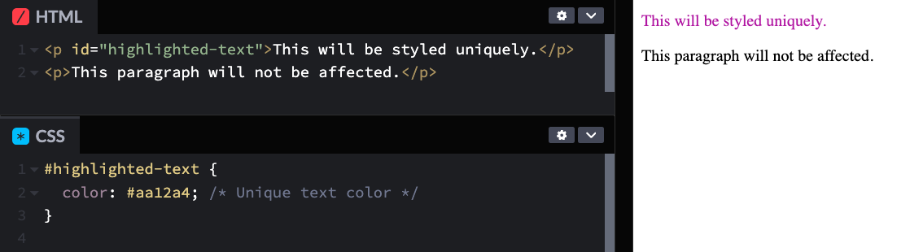

**Important Notes:**

- **IDs must be unique!** You can only use the same `id` **once** in your HTML.

- If you need to style multiple elements the same way, use a **class instead of an ID**. IDs are best used when you’re certain the element will be **one of a kind** on the page.

---

<h1 class="slide-header">Working with Classes</h1>

A **class** allows you to apply the same style to **multiple elements** on a webpage. Instead of styling each element separately, you can assign a **class name** to several elements and target that class in CSS using the `.` character.

**How to Use a Class:**

1. Add a `class` attribute to the elements you want to style.
2. Use the class name in CSS with a `.` before it.

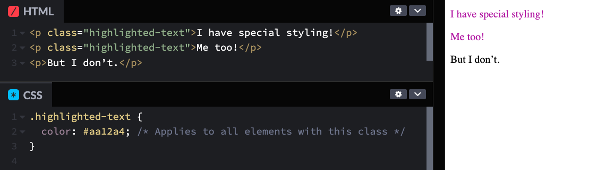

**Pro Tip:** Use a class when you expect to have **multiple elements** that should look the same, like headings, buttons, or image containers!

---

<h1 class="slide-header">Overruled!</h1>

When we start using **classes** and **IDs** alongside element selectors, we might run into **conflicting CSS rules**.

If multiple rules target the **same element**, the browser follows a **specificity hierarchy** to determine which style applies. The **most specific selector wins!**

**CSS Specificity Order**

1. **IDs (`#id-name`)** – Most specific
2. **Classes (`.class-name`)** – Less specific than IDs but more specific than element selectors
3. **Element selectors (`p`, `h1`, `div`)** – Least specific
4. **The Cascade** – If two rules have the **same specificity**, the one that appears **later in the CSS file** will be applied. CSS reads styles **top to bottom**, so the last conflicting rule wins.

---

<h1 class="slide-header">Specificity in Action</h1>

**What is happening here?**

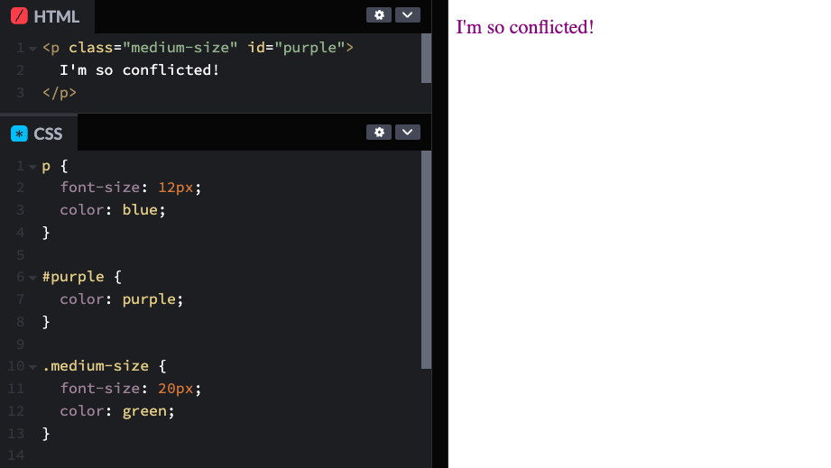

Even if CSS rules appear in different places in the stylesheet, **specificity** determines which one applies.

In the example above:

- The `p` selector sets **blue text** and **12px font size**.
- The `.medium-size` class **overrides the font size** to **20px** and changes the text to **green**.
- The `#purple` ID **takes priority** and sets the **text color to purple**.

**Final result:** The paragraph will have **purple text** and a **font size of 20px** because **IDs override classes, and classes override element selectors**.

If a style isn’t applying as expected, check if a **more specific rule** is taking over!

---

<h1 class="slide-header">Knowledge Check</h1>

Another client has asked you to style the **sidebar** on their portfolio website. The sidebar contains:

- A heading
- A subheading
- Two bio paragraphs
- Three Social media icons

Right now, all the text is the same color. How would you style **only the two bio paragraphs** to be blue, without affecting other text on the page?

<details>  
  <summary>Click to see the answer</summary>

Since there are multiple paragraphs on the page, the best approach is to assign a <strong>class</strong> to the two bio paragraphs. This ensures that only the bio paragraphs are affected, leaving other paragraphs unchanged.

</details>

---

<h1 class="slide-header">Making Hannah's Website Classy</h1>

Let’s revisit Hannah’s website and use **IDs** and **classes** to apply styles more precisely.

**1. Add an `id` to the introduction paragraph- Find the introduction paragraph in the HTML and add `id="introduction"` to the `<p>` tag.**

**2. Style the introduction paragraph in CSS - Create a CSS rule targeting `#introduction` and set the font size to `1.2em` to make it stand out more.**

**3. Add a `class` to the social media Icons - Find the `` elements inside the social media list and add `class="social"` to each icon.**

**4. Style the social media icons in CSS - Create a CSS rule targeting `.social` and set the width to `30px` and height to `30px` so all icons are the same size.**

Once you’ve added these styles, check the website to see how it looks!

<!-- styling-text-with-css-hannahs-site-8 -->
<iframe sandbox="allow-scripts allow-top-navigation allow-top-navigation-by-user-activation allow-forms allow-popups allow-same-origin"  height="400" style="width: 100%;" scrolling="no" title="Making Hannahs Website Classy" src="https://codepen.io/GAmarketing/embed/LEYLxLp?default-tab=css%2Cresult&editable=true" frameborder="no" loading="lazy" allowtransparency="true" allowfullscreen="true">
  See the Pen <a href="https://codepen.io/GAmarketing/pen/LEYLxLp">
  Making Hannahs Website Classy</a> by General Assembly (<a href="https://codepen.io/GAmarketing">@GAmarketing</a>)
  on <a href="https://codepen.io">CodePen</a>.
</iframe>

<small><strong>TIP:</strong> After updating your code, click the <strong>"Run"</strong> or <strong>"Rerun"</strong> button in CodePen to make sure your changes take effect. Then, check <strong>View Test Results</strong> to see if your updates pass!</small>

---

<h1 class="slide-header">Great Progress</h1>

Hannah’s website is really coming together! The colors, fonts, and text styles are looking amazing.

But there’s one last thing—**layout!** Right now, some elements feel a little out of place.

In the next section, we’ll dive into **position and spacing**—giving elements the room to breathe and making everything look more professional.

Get ready to bring it all together!

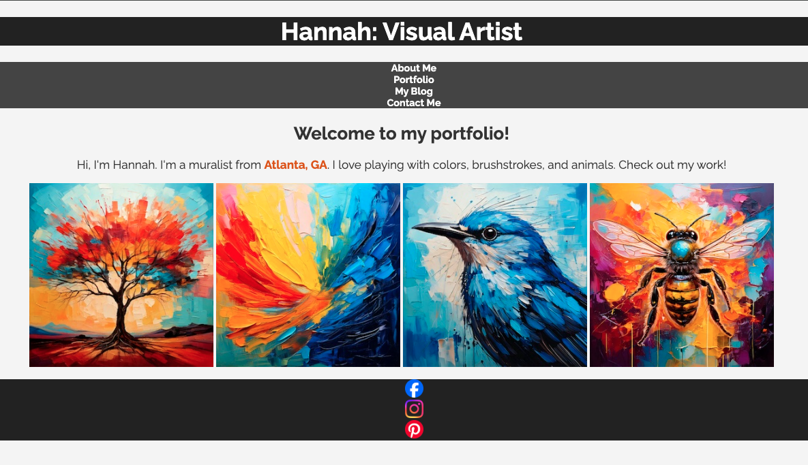

---

<h1 class="slide-header">Conclusion</h1>

Are you excited about text styling yet? If not, these resources will definitely inspire you:

- **[More ways to style text in CSS](https://1stwebdesigner.com/css3-text-effects-typography/)** – Explore creative text effects and typography techniques.
- **[Text-styling code snippets](https://envato.com/blog/css3-typography-code-snippets/)** – A collection of ready-to-use CSS snippets for stylish typography.
- **[Beautiful Web Type](http://hellohappy.org/beautiful-web-type/)** – A showcase of amazing fonts and how to use them effectively in web design.

Check them out and take your text styling skills to the next level!

</textarea>
